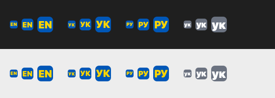

# AURA Switcher

> 🇺🇦  Designed and developed in Ukraine.
> Українська версія — [README.uk.md](README.uk.md)

A macOS & Windows app that fixes text typed in the wrong keyboard layout ("ghbdsn" → "привіт"). It lives in the menu bar, runs in the background and starts automatically at login.

Quick start — [docs/INSTALL-mac.md](docs/INSTALL-mac.md).

Website — https://klbk.github.io/aura-switcher/ · Support ☕ — https://donatello.to/aura-switcher

## Open source & support

- **Open source:** https://github.com/klbk/aura-switcher-app (GPL-3.0). The app sees everything you type, so anyone can check that it stores nothing and sends nothing online.
- **Free.** If AURA Switcher helps you, support development: **https://donatello.to/aura-switcher** ☕ (any country's card). The link is also on the website and in the app menu ("Support AURA Switcher ☕").
- **Download:** https://github.com/klbk/aura-switcher/releases/latest
- **Contact & bugs:** auraswitcher@gmail.com — or "Report a problem…" in the app menu (the email opens with version, system and layouts filled in).

## Features

- **Auto-correction.** Typed a word in the wrong layout and pressed Space — AURA erases the word, retypes it in the right layout and switches the layout.
- **Double ⇧** (two quick Shift taps):
  - text selected — converts it to the next layout (press again for the next one, in a cycle);
  - no selection — converts the last typed word;
  - nothing to convert — just switches the layout.
- **Exclusions.** AURA does nothing in the apps you choose.
- **Per-app language.** The layout is set automatically when you switch to an app (e.g. Terminal → EN). Auto-correction is off in apps with a bound language.
- **Single instance.** A second running copy of AURA quits immediately, so text is never corrected twice.
- **Games.** AURA pauses itself in games (double ⇧ is often sprint there): on Mac — apps in the Games category, on Windows — full-screen games. A game AURA didn't recognise can be excluded after leaving it: menu → "Don't work in (recent apps)".
- **Updates without going online.** AURA itself never sends or downloads anything. Menu → "Check for updates…" opens the releases page in the browser. 30 days after the build (or after the last check) a dot appears next to the language code and the menu says "⬆︎ An update may be available — check".

## Languages

AURA uses **every layout enabled in macOS**: System Settings → Keyboard → Input Sources → "+". New layouts are picked up instantly.

| Feature | Works with |
|---|---|
| Double ⇧ | any regular keyboard layout |
| Auto-correction | languages with a macOS dictionary: Ukrainian, English, Russian, German, French, Spanish, Italian, Portuguese, Polish, Turkish, Dutch, Czech, Swedish, Finnish, Romanian, Hungarian, Greek, Bulgarian, Hebrew, Arabic, Hindi, Korean |
| Not supported | Chinese, Japanese (input via candidates, not via a layout) |

**UK ↔ RU** is corrected: "міло" → "мыло", "вібор" → "выбор". If a word is spelled the same in both layouts ("привет"), the text stays and AURA only switches the layout. Words valid in both languages ("сир", "мі") are left alone — use double ⇧ for those.

Auto-correction is skipped between similar Latin layouts (EN ↔ DE ↔ FR): there a typo can't be told apart from a layout mistake. Use double ⇧ for those.

## Menu bar

The icon shows the current language: `EN`, `УК`, `РУ`… — each language in its own script (`ΕΛ` for Greek, `DE` for German). Lowercase (`en`, `ук`) — AURA is off or paused in this app (exclusion, game). `⚠︎` — no access.

- **Enabled** — master switch.
- **Auto-correction** — on/off (double ⇧ always works).
- **Sound** — a short beep: one tone on auto-correction, two on double ⇧. Same on Mac and Windows.
- **Don't work in this app** — add the current app to exclusions.
- **Language for this app** — bind a layout.
- **Exclusions / Language bindings** — lists; click an item to remove it.
- **Word exceptions…** — your words AURA never auto-corrects (slang like «хз», «ща», «яж»). Comma-separated; double ⇧ still works on them.
- **Launch at login**.
- **Menu language** — System or one of 21 languages (same as the site). "System" follows the OS language; Russian → Ukrainian; a language not in the list → English.
- **Quit**.

## Install and run

1. Build and install (also launches it):
   ```
   ~/Repo/aura-switcher/build.sh
   ```
   Requires Xcode or Command Line Tools (`swiftc`). Installs to `/Applications/AURA Switcher.app`.
2. Grant access: System Settings → Privacy & Security → **Accessibility** → enable AURA. Until then the menu shows `⚠︎`; once enabled, AURA starts working by itself, no restart needed.
3. After that it starts at login. Manually — Spotlight (⌘Space) → "AURA".

Archive for other Macs: `~/Repo/aura-switcher/build.sh --release` → `dist/AURA-Switcher-<version>.zip`.

## Troubleshooting

- **Doesn't correct, icon shows `⚠︎`** — no access, see step 2. If access is on but nothing works: toggle AURA off and on in the Accessibility list.
- **Wrong correction** — add the app to exclusions or turn auto-correction off; double ⇧ brings the word back.
- **Something hangs** — icon → "Quit", or `pkill "AURA Switcher"` in Terminal.
- **Uninstall** — "Quit", uncheck "Launch at login", delete `/Applications/AURA Switcher.app`.

## How it works

- A single Swift file: `~/Repo/aura-switcher/main.swift` (public repo https://github.com/klbk/aura-switcher-app), build script `build.sh` next to it. No external dependencies. Universal build: Apple Silicon + Intel.
- Keystrokes are read with a **listen-only** `CGEventTap`: the system never waits for AURA, so it can't freeze the keyboard or mouse.
- Character tables are built from the macOS layouts themselves (`UCKeyTranslate`), so any layout works without manual setup.
- Word checking uses the system spell checker (`NSSpellChecker`), after the Space has already been typed.
- Replacement uses synthetic keystrokes: Backspace × word length, then the corrected text.
- Selected text comes from the Accessibility API, or via ⌘C with clipboard restore if the app doesn't expose it.
- Settings are stored in `UserDefaults` (`com.chernov.aura`).

## Windows (beta, tested on Windows x64)

- Windows 10/11, x64 and ARM64 (ARM64 not tested yet). Archives: `~/Repo/aura-switcher/dist/AURA-Switcher-0.7-windows-x64.zip` (regular PCs, ~210 KB) and `AURA-Switcher-0.7-windows-arm64.zip` (ARM laptops: Snapdragon, Surface Pro X). No installer — copy `AURA Switcher.exe` anywhere and run it.
- Build on a Mac: `~/Repo/aura-switcher/windows/build.sh` (needs Zig, located in `~/.local/zig`).
- Same features and menu as on Mac. The tray icon shows the language code: yellow letters on a rounded blue tile (grey — disabled), drawn at the exact tray size so it stays sharp.
   Click the icon for the menu.
- Double ⇧ works the same as on Mac. To stop the "Sticky Keys" prompt after a few double ⇧, AURA turns off only its shortcut (5× Shift) while running. Not saved: quitting AURA or rebooting restores it.
- No permissions needed. Autostart via registry (`HKCU\…\Run`), settings in `HKCU\Software\AURA`.
- Word checking uses the built-in Windows spell checker; works for languages installed in Windows (Settings → Time & language → Language).
- Selected text is read only via Ctrl+C (clipboard is restored).
- Can't see keystrokes in apps running as administrator (a Windows restriction).
- Windows SmartScreen warns about an unknown publisher: "More info" → "Run anyway". Only code signing removes it.
- How it works: `windows/aura.cpp`, a single C++/Win32 file. The keyboard hook runs on its own thread and only records keystrokes; checking and replacement happen on the main thread, so typing never lags.

## Limitations

- macOS 13+ and Windows 10/11. On iPhone/iPad/Android only as a separate keyboard, with little practical value.
- Auto-correction only sees continuous typing: a mouse click, arrow keys or ⌘/⌥/⌃ shortcuts reset the current word.
- Password fields and some apps (terminals, games) may behave differently — add them to exclusions.

---
🇺🇦 AURA Switcher — made in Ukraine.
