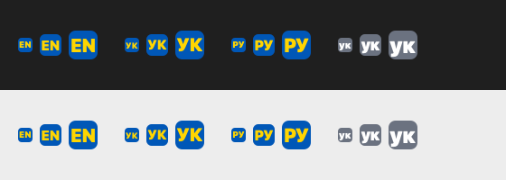

# AURA Switcher

> 🇺🇦 Створено в Україні.
> English version — [README.md](README.md)

Програма для macOS і Windows, яка виправляє текст, набраний не в тій розкладці («ghbdsn» → «привіт»). Живе іконкою в рядку меню (Mac) або в треї (Windows), працює у фоні й сама запускається під час входу в систему.

Коротко про запуск — [docs/INSTALL-mac.uk.md](docs/INSTALL-mac.uk.md).

Сайт — https://klbk.github.io/aura-switcher/ · Підтримати ☕ — https://donatello.to/aura-switcher

## Відкритий код і підтримка

- **Код відкритий:** https://github.com/klbk/aura-switcher-app (ліцензія GPL-3.0). Програма бачить усе, що ви набираєте, тому кожен може перевірити: вона нічого не зберігає і не передає те, що ви набираєте.
- **Безкоштовно.** Якщо AURA Switcher вам допомагає — підтримайте розробку: **https://donatello.to/aura-switcher** ☕ (картка будь-якої країни). Посилання також є на сайті та в меню програми («Підтримати AURA Switcher ☕»).
- **Завантажити:** https://github.com/klbk/aura-switcher/releases/latest
- **Зв'язок і помилки:** auraswitcher@gmail.com — або в меню програми «Повідомити про проблему…» (лист відкриється з уже вписаними версією, системою й розкладками).

## Можливості

- **Автовиправлення.** Набрали слово не в тій розкладці й натиснули пробіл — AURA стирає слово, друкує його в правильній розкладці та перемикає розкладку.
- **Подвійний ⇧** (два швидкі натискання Shift):
  - є виділений текст — переводить його в наступну розкладку (повторне натискання — у наступну, по колу);
  - виділення немає — переводить останнє набране слово;
  - нічого перекладати — просто перемикає розкладку.
- **Винятки.** У вибраних програмах AURA нічого не робить.
- **Прив'язка мови до програми.** Під час переходу в програму розкладка ставиться автоматично (наприклад, Terminal → EN). У програмах із прив'язкою автовиправлення вимкнене.
- **Лише одна копія.** Друга запущена AURA одразу закривається, щоб не виправляти текст двічі.
- **Ігри.** У іграх AURA сама стає на паузу (подвійний ⇧ там часто — біг): на Mac — програми категорії «Ігри», на Windows — ігри на весь екран. Гру, яку AURA не розпізнала, можна виключити вже після виходу з неї: меню → «Не працювати в (останні програми)». Пауза діє і в чаті гри: слово, набране там не в тій розкладці, лишиться як є.
- **Оновлення в один клік, лише коли ви просите.** AURA виходить в інтернет тільки після «Перевірити оновлення…» в меню: читає файл версії на klbk.github.io і, якщо ви погодитесь, завантажує нову версію з GitHub Releases, перевіряє її (Mac — підпис AURA й номер версії; Windows — підписаний файл версії та SHA-256 exe), ставить замість старої й перезапускається. Набраний текст і особисті дані не передаються. Якщо щось піде не так, програма запропонує сторінку оновлення на сайті (в її адресі лише номер версії та мова меню). Через 30 днів після встановлення (або після останньої перевірки) біля коду мови з'являється крапка, а в меню — «⬆︎ Можливо, вийшло оновлення — перевірити».

## Мови

AURA використовує **всі розкладки, увімкнені в macOS**: Системні параметри → Клавіатура → Джерела введення → «+». Нова розкладка підхоплюється одразу.

| Функція | Де працює |
|---|---|
| Подвійний ⇧ | будь-яка звичайна розкладка |
| Автовиправлення | українська, англійська, російська, білоруська, німецька, французька, іспанська, італійська, португальська, польська, турецька, нідерландська, чеська, шведська, фінська, румунська, угорська, грецька, болгарська, іврит, арабська — зі словником macOS, а без нього — із власною мовною моделлю AURA |
| Не працює | китайська, японська (введення через підказки, а не через розкладку); автовиправлення для корейської та гінді — пізніше |

**UK ↔ RU** виправляється: «міло» → «мыло», «вібор» → «выбор». Якщо слово однаково пишеться в обох розкладках («привет»), текст не змінюється — AURA лише перемикає розкладку. Слова, правильні в обох мовах («сир», «мі»), не чіпаються — для них подвійний ⇧.

Між латинськими розкладками (EN ↔ DE ↔ FR…) слово виправляється, якщо воно справжнє лише в іншій розкладці: «sch;n» → «schön». Літера з наголосом через мертву клавішу (´, потім e) рахується як одна.

## Меню в рядку меню

Іконка показує поточну мову: `EN`, `УК`, `РУ`… — кожна мова своєю абеткою (`ΕΛ` для грецької, `DE` для німецької). Малими літерами (`en`, `ук`) — AURA вимкнена або на паузі в цій програмі (виняток, гра). `⚠︎` — немає доступу.

- **Увімкнено** — загальний вимикач.
- **Автовиправлення** — увімкнути/вимкнути автовиправлення (подвійний ⇧ працює завжди).
- **Звук** — короткий сигнал: один тон при автовиправленні, два — при подвійному ⇧. Однаковий на Mac і Windows.
- **Не працювати в цій програмі** — додати поточну програму до винятків.
- **Мова для цієї програми** — прив'язати розкладку.
- **Винятки / Прив'язки мов** — списки; клік по пункту видаляє його.
- **Мої слова…** — слова, які AURA вважає правильними (сленг на кшталт «хз», «ща», «скілі»): не змінює їх, а набрані не в тій розкладці — виправляє на них (`crsks` → «скілі»). Через кому.
- **Запускати під час входу**.
- **Мова меню** — Системна або одна з 21 мови (як на сайті). «Системна» — мова системи; російська система → українська; мови, якої немає в списку, → англійська.
- **Вихід**.

## Встановлення і запуск

1. Зібрати й встановити (заодно запускає):
   ```
   ./build.sh
   ```
   Потрібен Xcode або Command Line Tools (`swiftc`). Програма ставиться в `/Applications/AURA Switcher.app`.
2. Надати доступ: Системні параметри → Конфіденційність і безпека → **Універсальний доступ** → увімкнути AURA. Поки доступу немає, у меню `⚠︎`; після увімкнення AURA запрацює сама, без перезапуску.
3. Далі запускається сама під час входу. Вручну — Spotlight (⌘Пробіл) → «AURA Switcher».

Архів для інших Mac: `./build.sh --release` → `dist/AURA-Switcher-<версія>.zip`.

## Якщо щось не так

- **Не виправляє, іконка `⚠︎`** — немає доступу, див. крок 2. Якщо доступ увімкнено, але не працює: вимкніть і знову увімкніть AURA у списку «Універсальний доступ».
- **Виправила неправильно** — додайте програму до винятків або вимкніть автовиправлення; подвійний ⇧ поверне слово.
- **Щось підвисає** — іконка → «Вихід», або в Терміналі `pkill "AURA Switcher"`.
- **Видалити зовсім** — «Вихід», зняти «Запускати під час входу», видалити `/Applications/AURA Switcher.app`.

## Як влаштовано

- Один файл на Swift: `main.swift` (відкритий репозиторій https://github.com/klbk/aura-switcher-app), збірка — `build.sh` там само. Без зовнішніх залежностей. Універсальна збірка: Apple Silicon + Intel.
- Натискання читаються через `CGEventTap` у режимі **лише читання**: система не чекає на AURA, тому програма не може підвісити клавіатуру чи мишу.
- Таблиці символів будуються з самих розкладок macOS (`UCKeyTranslate`), тому будь-яка розкладка підтримується без ручного налаштування.
- Перевірка слів — системна перевірка правопису (`NSSpellChecker`), виконується після того, як пробіл уже надруковано. Незавантажений словник macOS приймає будь-який рядок, тому кожен спершу перевіряється на нісенітниці.
- Де робочого словника немає, AURA бере власні мовні моделі (`lang/`, збирає `tools/langmodel.py`): часті слова й трійки літер. Дані: [FrequencyWords](https://github.com/hermitdave/FrequencyWords) (Hermit Dave) і білоруська Вікіпедія, обидва CC BY-SA 4.0.
- Заміна тексту — синтетичні натискання: Backspace × довжина слова, потім друк виправленого тексту.
- Виділений текст береться через Accessibility API, а якщо програма його не віддає — через ⌘C з відновленням буфера обміну.
- Налаштування зберігаються в `UserDefaults` (`com.chernov.aura`).

## Windows (бета, перевірена на Windows x64)

- Windows 10/11, x64 і ARM64 (ARM64 ще не перевірена). Архіви в релізі (https://github.com/klbk/aura-switcher/releases/latest): `AURA-Switcher-windows-x64.zip` (звичайні ПК, ~210 КБ) і `AURA-Switcher-windows-arm64.zip` (ноутбуки на ARM: Snapdragon, Surface Pro X). Встановлення не потрібне — скопіюйте `AURA Switcher.exe` куди завгодно й запустіть.
- Збірка на Mac: `windows/build.sh` (потрібен [Zig](https://ziglang.org); шлях до нього — `ZIG=…`, за замовчуванням `~/.local/bin/zig`).
- Ті самі функції й меню, що на Mac. Іконка в треї показує код мови: жовті літери на синій заокругленій плитці (сіра — вимкнено), малюється точно під розмір трею, тож не розмивається.
   Клік по іконці — меню.
- Подвійний ⇧ — так само, як на Mac. Щоб після кількох подвійних ⇧ не вискакувало вікно «Залипання клавіш», AURA на час роботи вимикає лише його гарячу клавішу (5× Shift). Зміна не зберігається: при виході з AURA чи перезавантаженні все повертається.
- Дозволи не потрібні. Автозапуск — через реєстр (`HKCU\…\Run`), налаштування — `HKCU\Software\AURA`.
- Перевірка слів — вбудована перевірка правопису Windows; працює для мов, встановлених у Windows (Параметри → Час і мова → Мова).
- Виділений текст береться лише через Ctrl+C (з відновленням буфера обміну).
- Не бачить натискань у програмах, запущених від імені адміністратора (обмеження Windows).
- Windows SmartScreen попередить про невідомого видавця: «Докладніше» → «Усе одно запустити». Прибирається лише підписом коду.
- Як влаштовано: `windows/aura.cpp`, один файл C++/Win32. Хук клавіатури працює в окремому потоці й лише запам'ятовує натискання; перевірка й заміна — в основному потоці, тож введення не гальмує.

## Обмеження

- macOS 13+ і Windows 10/11. На iPhone/iPad/Android — лише як окрема клавіатура, практичної користі мало.
- Автовиправлення бачить лише набір підряд: після кліку мишею, стрілок або сполучень із ⌘/⌥/⌃ поточне слово забувається.
- У полях пароля та деяких програмах (термінали, ігри) поведінка може відрізнятися — додайте їх до винятків.

## Подяки

- **Andrew Vrublevskyi** ([@andreyrubleff](https://github.com/andreyrubleff)) — бета-тестування й рев'ю коду 0.9.2, завдяки якому оновлення в один клік стало безпечнішим (0.9.3).
- **mrCabez** ([@mrCabez](https://github.com/mrCabez)) — вичитка італійського перекладу носієм мови (меню, сайт, сторінка оновлення).

---
🇺🇦 AURA Switcher — українська розробка.
