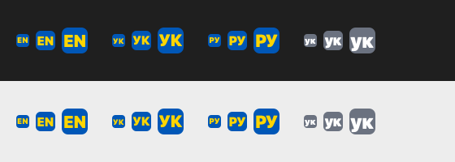

# AURA Switcher — Windows (beta, tested on Windows x64)

> Українською — [windows.uk.md](windows.uk.md) · ← [README](../README.md)

- Windows 10/11, x64 and ARM64 (ARM64 not tested yet). Archives in the release (https://github.com/klbk/aura-switcher/releases/latest): `AURA-Switcher-windows-x64.zip` (regular PCs, ~210 KB) and `AURA-Switcher-windows-arm64.zip` (ARM laptops: Snapdragon, Surface Pro X). No installer — copy `AURA Switcher.exe` anywhere and run it.
- Build on a Mac: `windows/build.sh` (needs [Zig](https://ziglang.org); path to it — `ZIG=…`, default `~/.local/bin/zig`).
- Same features and menu as on Mac. The tray icon shows the language code: yellow letters on a rounded blue tile (grey — disabled), drawn at the exact tray size so it stays sharp.
   Click the icon for the menu.
- Double ⇧ works the same as on Mac. To stop the "Sticky Keys" prompt after a few double ⇧, AURA turns off only its shortcut (5× Shift) while running. Not saved: quitting AURA or rebooting restores it.
- Correction key: menu → "Correction key" (default double ⇧, or Ctrl / Alt / off). Double Ctrl is taken in JetBrains IDEs; with Alt, AURA sends an unassigned key while Alt is held so a lone Alt tap doesn't open the program's menu bar (and Alt alone can no longer be used to reach it). Shift is the safest.
- No permissions needed. Autostart via registry (`HKCU\…\Run`), settings in `HKCU\Software\AURA`.
- Word checking uses the built-in Windows spell checker; works for languages installed in Windows (Settings → Time & language → Language).
- Selected text is read only via Ctrl+C (clipboard is restored).
- Can't see keystrokes in apps running as administrator (a Windows restriction).
- Windows SmartScreen warns about an unknown publisher: "More info" → "Run anyway". Only code signing removes it.
- How it works: `windows/aura.cpp`, a single C++/Win32 file. The keyboard hook runs on its own thread and only records keystrokes; checking and replacement happen on the main thread, so typing never lags.
