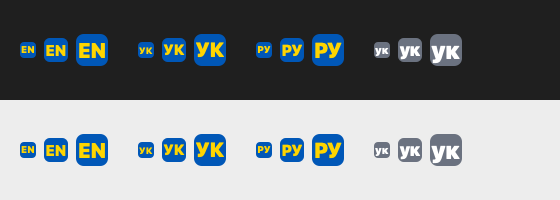

# AURA Switcher — Windows (бета, перевірена на Windows x64)

> English — [windows.md](windows.md) · ← [README.uk](../README.uk.md)

- Windows 10/11, x64 і ARM64 (ARM64 ще не перевірена). Архіви в релізі (https://github.com/klbk/aura-switcher/releases/latest): `AURA-Switcher-windows-x64.zip` (звичайні ПК, ~210 КБ) і `AURA-Switcher-windows-arm64.zip` (ноутбуки на ARM: Snapdragon, Surface Pro X). Встановлення не потрібне — скопіюйте `AURA Switcher.exe` куди завгодно й запустіть.
- Збірка на Mac: `windows/build.sh` (потрібен [Zig](https://ziglang.org); шлях до нього — `ZIG=…`, за замовчуванням `~/.local/bin/zig`).
- Ті самі функції й меню, що на Mac. Іконка в треї показує код мови: жовті літери на синій заокругленій плитці (сіра — вимкнено), малюється точно під розмір трею, тож не розмивається.
   Клік по іконці — меню.
- Подвійний ⇧ — так само, як на Mac. Щоб після кількох подвійних ⇧ не вискакувало вікно «Залипання клавіш», AURA на час роботи вимикає лише його гарячу клавішу (5× Shift). Зміна не зберігається: при виході з AURA чи перезавантаженні все повертається.
- Клавіша виправлення: меню → «Клавіша виправлення» (типово подвійний ⇧, або Ctrl / Alt / вимкнено). Подвійний Ctrl зайнятий у JetBrains; з Alt AURA посилає непризначену клавішу, поки Alt затиснутий, щоб одиночний Alt не відкривав рядок меню програми (а Alt окремо більше не відкриває меню). Shift найбезпечніший.
- Дозволи не потрібні. Автозапуск — через реєстр (`HKCU\…\Run`), налаштування — `HKCU\Software\AURA`.
- Перевірка слів — вбудована перевірка правопису Windows; працює для мов, встановлених у Windows (Параметри → Час і мова → Мова).
- Виділений текст береться лише через Ctrl+C (з відновленням буфера обміну).
- Не бачить натискань у програмах, запущених від імені адміністратора (обмеження Windows).
- Windows SmartScreen попередить про невідомого видавця: «Докладніше» → «Усе одно запустити». Прибирається лише підписом коду.
- Як влаштовано: `windows/aura.cpp`, один файл C++/Win32. Хук клавіатури працює в окремому потоці й лише запам'ятовує натискання; перевірка й заміна — в основному потоці, тож введення не гальмує.
